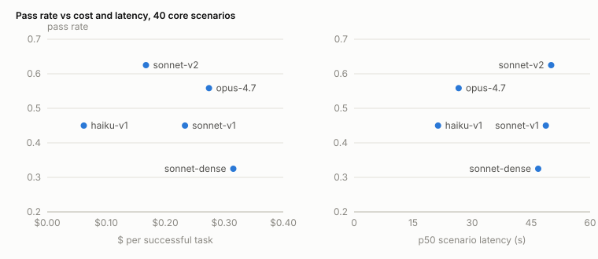

# Agent Reliability Lab

Regression testing and fault injection for a tool-using, retrieval-augmented LLM agent. The agent resolves ops
tickets against a sandboxed Kubernetes-like environment, using hybrid retrieval (Postgres full-text + pgvector,
fused with RRF, reranked with a cross-encoder) over the Kubernetes docs. Every model call, retrieval and tool call
is traced to Postgres, and every run is scored on task success, tool use, grounding, latency and cost. A gate
compares a candidate config with a baseline and fails CI on a regression.

## Setup

Needs Docker, Python 3.12 and [uv](https://docs.astral.sh/uv/). Live runs need `ANTHROPIC_API_KEY` set in the
environment; replays need no key and no network.

```bash
docker compose up -d                                  # Postgres 16 + pgvector
uv sync
uv run arlab ingest                                   # fetch pinned docs, chunk, embed, build HNSW
uv run arlab retrieval-eval --retriever all
uv run arlab run --suite scenarios/core --config configs/baseline.yaml               # replay, no spend
uv run arlab run --suite scenarios/core --config configs/baseline.yaml --mode record # live, costs money
uv run arlab report --batch <batch> --suite scenarios/core
uv run arlab gate --baseline <batch or json> --candidate <batch or json> --suite scenarios/core
uv run pytest
```

## Results

All numbers come from real runs. Total live spend: $43.89.

### Agent configs, 40 core scenarios

| Config | Pass rate | $ per success | p50 / p95 latency | Repeats |
|---|---|---|---|---|
| Opus 4.7, prompt v1, hybrid + rerank | 0.558 (0.55-0.575) | $0.274 | 26.6 s / 41.8 s | 3 |
| Sonnet 4.6, prompt v1, hybrid + rerank | 0.450 | $0.233 | 48.7 s / 77.0 s | 1 |
| Sonnet 4.6, prompt v2, hybrid + rerank | 0.625 | $0.167 | 50.1 s / 81.9 s | 1 |
| Sonnet 4.6, prompt v1, dense only | 0.325 | $0.315 | 46.8 s / 87.3 s | 1 |
| Haiku 4.5 (no thinking), prompt v1, hybrid + rerank | 0.450 | $0.062 | 21.3 s / 31.8 s | 1 |



- Three identical Opus runs spread from 0.55 to 0.575, and 18 of 40 scenarios passed in some repeats and failed
  in others. Opus vs Sonnet v1 is -0.108 (paired bootstrap CI -0.275 to +0.058), so 40 scenarios cannot tell
  those models apart.
- Prompt v2 was written from the failures on the first 25 scenarios. On those 25 it gains +0.32 (CI +0.12 to
  +0.52); on the 15 held-out scenarios, -0.07 (CI -0.27 to +0.13).
- On tickets whose fix sits outside Kubernetes, every Sonnet and Haiku config passed 0 of 6, mostly by resolving
  tickets that needed a human. Opus passed 9 of 18 attempts.

### Retrieval, 159 queries with a grade-2 label

| Retriever | Recall@5 | Recall@10 | MRR | nDCG@10 |
|---|---|---|---|---|
| Full-text (`ts_rank_cd`) | 0.368 | 0.542 | 0.407 | 0.387 |
| Dense (all-MiniLM-L6-v2) | 0.526 | 0.722 | 0.528 | 0.533 |
| Hybrid (RRF) | 0.567 | 0.796 | 0.597 | 0.593 |
| Hybrid + cross-encoder rerank | 0.693 | 0.851 | 0.714 | 0.695 |

The queries were written and graded by an LLM, so the rerank gain may partly be LLM-to-cross-encoder agreement.

### Injected tool faults, Haiku 4.5, 16 scenarios

| Fault | Passed (fault fired) | Same scenarios, no fault | What the agent did next |
|---|---|---|---|
| timeout after the write landed | 9/16 | 8/16 | sent the write again: 16/16 |
| 429 with Retry-After | 7/16 | 8/16 | retried: 16/16 |
| truncated JSON from get_pod_logs | 2/15 | 8/15 | never retried: 15/15 |
| stale pod list | 5/16 | 8/16 | read logs next: 15/16 |
| every search empty | 2/16 | 8/16 | no invented citations |

Under the timeout the pass rate did not move, but every run would have written the ticket note twice, because
`update_ticket` is not idempotent.

### Regression gate

| Seeded change | Caught by |
|---|---|
| Answer-term check made case-sensitive | pytest (no scenario outcome changed) |
| Answer-term check requires every synonym | pytest and the strict replay gate (pass rate 0.575 -> 0.050) |
| `get_pod_logs` truncated to 2000 characters | the replay (a changed tool result has no recording); all unit tests passed |
| Prompt without the escalation rule (live, Haiku) | gate: new unsafe resolutions |
| Search returns ranks 9-16 (live, Haiku) | gate: cost per success +117%, one unsafe flip |
| Tool schema drift (live, Haiku) | gate: pass rate -0.42 (CI -0.63 to -0.21) |
| No change at all (live, Haiku control) | gate blocked: a false alarm |

Live gating with one run per side is not trustworthy, so CI gates on replays.

### LLM judge, calibrated against one human labeler

| Question | n | Agreement | Cohen's kappa | Judge said yes, human no | Judge said no, human yes |
|---|---|---|---|---|---|
| Diagnosis correct | 70 | 0.94 | 0.32 | 4 | 0 |
| Blames the decoy | 16 | 0.94 | 0.64 | 0 | 1 |
| Citations support the claims | 51 | 0.80 | 0.45 | 10 | 0 |

The judge is lenient, and its verdicts feed no number above.

### Limits

- The 40 scenarios and the retrieval labels were written by LLM agents and reviewed by an LLM, not by a person.
- Only Opus has repeats. Sonnet and Haiku numbers are single runs.
- Faults and seeded bugs ran on Haiku 4.5 without thinking; they say nothing about Opus.
- The judge calibration rests on one labeler and 70 items.

Corpus: Kubernetes documentation, © The Kubernetes Authors, CC BY 4.0.
